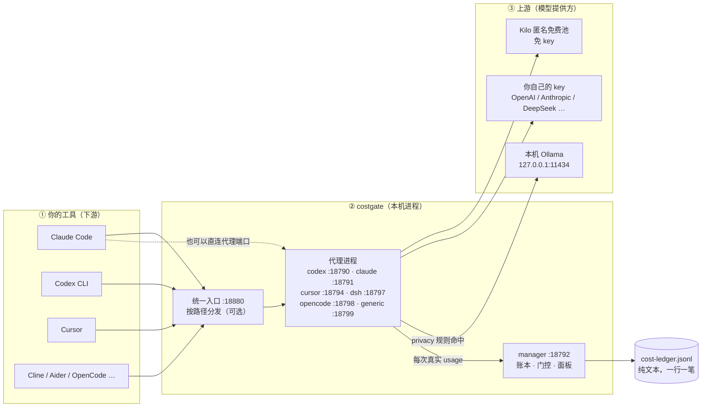

<!--
costgate — Copyright © 2026 sif-king (Jason)
Licensed under AGPL-3.0 (source) + Commercial license (see LICENSE-COMMERCIAL.md).
This file is part of the costgate project.
-->

# costgate

> **把你本机那些 AI 编码工具的模型请求收到一处，记一本你自己能查的花销账。**

装好只用一条命令，不用任何 API key。账本是磁盘上一个纯文本文件，另有一条只读命令把它读给你听——包括每项能力**真跑过几次**。

<sub>English: One local gateway for all your AI coding tools — with a ledger you can audit yourself.</sub>

[](https://github.com/sif-king/costgate/actions/workflows/e2e-tier0.yml)
[](https://github.com/sif-king/costgate/actions/workflows/p0-security-gate.yml)
[](LICENSE)
[](LICENSE-COMMERCIAL.md)

<sub>徽章图例：点开 CI 会看到历史里有 `cancelled` / `failed` 条目——那是 PR 迭代中的红→绿循环（含 GitHub runner 网络抖动触发的自动重试），**不是当前 main 的状态**；当前 HEAD 双门全绿。失败条目的上下文见 [`CHANGELOG.md`](CHANGELOG.md)。</sub>

> **想审计它的人，先看这三页**：[`COMPATIBILITY.md`](COMPATIBILITY.md)（它认哪些协议、到哪个版本、哪些不认）·
> [`SECURITY.md`](SECURITY.md)（它拦什么、放什么、你的数据去哪）· [`CHANGELOG.md`](CHANGELOG.md)（现在能用什么、已知限制）。
> 不写「我们很安全 / 支持一切」——写的是实测过的形态，没实测的写「未验」。

**跳着看**：[30 秒看懂它](#30-秒看懂它) · [跑起来](#一条命令看到第一笔真实账单) · [和别的东西什么关系](#它和别的东西什么关系) · [接上你的工具](#接上你的工具) · [数据不出本机](#数据不出本机) · [常见问题](#常见问题) · [还没做的](#现在还没做的)

如果你正在同时用 Claude Code、Codex CLI、Cursor、opencode、Cline、Aider 里的两个以上，并且说不清这个月 AI 花了多少、这些工具之间有没有互相抢配置——这就是给它用的。

---

## 30 秒看懂它

一句话：**它站在你的工具和模型之间，只做两件事——把出口收成一个，把花销记成一本账。**



三句话读完这张图：

1. **上面是你在用的工具**——它们只认一个 `base_url`，不关心背后是谁。
2. **中间是 costgate**——代理进程转发请求并拿到上游返回的真实 `usage`，manager 把它记成一行账。这层不做模型推理，也不改你的工具配置（只读；发现被别的工具占用时报告冲突，不抢不覆写）。
3. **下面是上游**——免费池 / 你自己的 key / 本机 Ollama。打上隐私标记的请求只落 `127.0.0.1`，这是路由表里的一档条件，不是临时开关。

> 图里没有 `hermes :18793`：它不在这条请求链路上——只改写 `~/.hermes/config.yaml` 的当前模型，不转发请求、不记账（细节见[「接上你的工具」](#接上你的工具)）。

---

## 一条命令，看到第一笔真实账单

先对号入座——**这是源码运行，不是 `.dmg` / `.exe` 安装包**（为什么还没做安装包，见「现在还没做的」）：

| 平台 | 怎么跑 | 状态 |
|---|---|---|
| macOS / Linux | `bash scripts/quickstart.sh` | ✅ 主路径（macOS 实测 21s 出第一笔账单） |
| Windows + Git Bash / WSL | 同上 | ✅ 与 macOS 同一套 bash 流程 |
| Windows 原生 PowerShell | `.\install.ps1` 装 + `.\manage.ps1` 起停 | ⚠️ 能装能跑，但**没有零 key 冷启向导**——那条向导是 bash 脚本 |

本机实测 7 秒到 97 秒，差别全在 npm 要不要现下依赖；脚本末尾会报这次的真实秒数，别把秒数当承诺。

```bash
git clone https://github.com/sif-king/costgate && cd costgate
bash scripts/quickstart.sh
```

它做五件事，每一步屏幕上都可核对：装依赖（只在首次）→ 找一个**免 key** 的上游（Kilo 匿名免费池 → 本机 Ollama）→ 起两个进程 → 发一条真实请求 → 打印账本里刚落地的那一行。

用 Claude Code？同一套流程换一个客户端，起的是 claude-proxy（Anthropic wire）：

```bash
MP_QS_CLIENT=claude bash scripts/quickstart.sh
```

```
costgate · 冷启：从零到第一笔真实账单
仓库：~/Documents/AI项目/multi-proxy
数据：/tmp/qs-readme-home/.multi-proxy-manager

[1/5] 检查端口
  ✓ 18886 空闲
  ✓ 18885 空闲
  ✓ manager 依赖已就绪
  ✓ codex-proxy 依赖已就绪

[2/5] 探测可用上游（零 key 优先）
  ✓ 上游：Kilo 匿名免费池（免账号·免 key）
  ✓ 模型：kilo-auto/free
  （首个请求会发往第三方免费池，可能被用于服务改进；本脚本只发一句 'pong'，不含你的任何内容）
  ✓ 已写入上游配置：/tmp/qs-readme-home/.multi-proxy-manager/providers.json

[3/5] 启动 manager（账本落盘方）
  ✓ manager 就绪 http://127.0.0.1:18886（pid 3802）

[4/5] 启动 codex-proxy（转发 + 取真实 usage）
  ✓ codex-proxy 就绪 http://127.0.0.1:18885（pid 3986）

[5/5] 发一条真请求，核对账本
  ✓ 上游回复：「pong」
  ✓ 本次真实用量：输入 50 · 输出 26 · 合计 76 tokens

  ┌─ 第一笔真实账单 ────────────────────────────────
  │ 时间    03:42:07
  │ 代理    codex-proxy     模型  kilo-auto/free
  │ 用量    输入 50     输出 26     缓存命中 0
  │ 计费    ¥0（免费额度，数字来自上游真实 usage）
  │ 耗时    2077ms
  └────────────────────────────────────────────────

冷启完成，用时 26s
```

<details>
<summary><b>上面这些数字为什么每次不一样（点开：实测环境、分段耗时、装失败了怎么办）</b></summary>

> 上面是 2026-11-08 03:42 在本机的一次真实输出：数值与步骤逐字保留，只把品牌名同步为更名后的 `costgate`、把本机路径脱敏成 `~`，末尾「下一步」几行提示未收录。为了不污染你自己的账本、也不和你已经在跑的服务抢端口，那次用的是空的 `HOME` 和 18886/18885 两个端口——**默认是 18792/18790**，其余输出与默认跑法完全一致。
>
> 换 `MP_QS_CLIENT=claude` 那次同样真跑：14 秒，账本里落地的是 `代理 claude-proxy`、用量 50/26。
>
> 「用时」是变量，别当承诺：同一条命令在这台机器上测到过 **7 / 11 / 13 / 14 / 18 / 26 秒**（依赖已就绪），慢网络下最差 **62 秒**。你自己的数字以屏幕为准。
>
> **首次跑要下依赖，所以慢**。2026-11-09 我从 GitHub 重新 clone 一份（`node_modules` 一个都没有）、换空的 `HOME`、换两个空闲端口整跑了一次：**95 秒**，脚本自己报的分段是 **依赖安装 79s · 探测上游+起服务+请求 16s**。也就是说：程序本身做的事始终是那十几秒，剩下全是你这台机器第一次从 npm 拿那 30 多个包。这段只在首次发生，之后重跑就是 18 秒那一档。
>
> 这条分段的用处不是好看：陌生人看到「95 秒」时，能立刻判断慢在自己的网络还是程序——这两件事的修法完全不同。之前只报一个总数的时候，我自己就误判过一次（把 npm 的下包时间当成程序慢）。
>
> 万一 `npm install` 本身失败，脚本会把 npm 的**原话**打到屏幕上（`首次安装没完成，npm 报的是：…`），见到这行先查自己的网络/代理，别当成安装器坏了。

</details>

那条命令背后真正发生的事：你的请求 → codex-proxy 转发到上游 → 上游返回 `usage` → 上报 manager → 追加写进 `~/.multi-proxy-manager/cost-ledger.jsonl`。

**token 数来自上游返回的 `usage` 字段**，不是估算、不是模拟。请求成功但账本没多一行，脚本会**以退出码 2 报错**并告诉你去哪看日志——"没记上"不会被说成"成功"。

> - 免费池会把 prompt 用于服务改进，别发敏感内容；脚本只发一句 `pong`。
> - 想数据不出本机：先装 [Ollama](https://ollama.com)，脚本自动优先用它，并挑**体积最小**的模型（机器上有 27B 和 4B 时不会挑 27B）。`MP_QS_UPSTREAM=ollama` 可强制走本地。
> - 停掉：`bash scripts/quickstart.sh --stop`。
> - **完整安全口径**（它拦什么、拦不住什么、你的数据去哪）：[`SECURITY.md`](SECURITY.md)。一句话先记住：**默认冷启会发往第三方免费池，想纯本地走 Ollama**。
> - **上游完整性不在范围**（`SECURITY.md §3`）：costgate 对上游是**透明转发**——不校验返回的工具调用签名、不对上游做版本 pin。要「上游可信」请在上游侧解决（TLS 证书 pinning / 自建上游），这层不做背书。

---

## 它和别的东西什么关系

这一段回答「我已经在用 X 了，还需要这个吗」。**先说它不是什么**，比说它是什么省时间：

- **不是多租户网关**：没有虚拟 key、没有按用户分账、没有 SSO。它服务**一台机器上的一个人**。
- **不是高可用路由**：核心链路是单次转发，没有 failover / 重试 / 熔断（详见[「现在还没做的」](#现在还没做的)）。
- **不是托管服务**：没有云端版本。除了你自己选的上游，请求不经过任何第三方中转。

| 你可能已经在用 | 它主要解决 | 和 costgate 重叠在哪 | 差在哪 —— 所以什么时候该用它 |
|---|---|---|---|
| [LiteLLM](https://github.com/BerriAI/litellm) | 团队自托管的 AI Gateway：100+ 模型统一成 OpenAI 格式、虚拟 key、按人/项目分账、负载均衡 | 都在「自托管出口层」，都记成本 | 它面向**平台团队**（多租户、发 key、企业级观测）；costgate 面向**一个人一台机器**。要给同事发 key、按项目分账 → 选它 |
| [Portkey Gateway](https://github.com/Portkey-AI/gateway) | 统一 API + guardrails（内容护栏）+ 条件路由 + 缓存 | 都是「一个地址接多个模型」 | 它的强项是**生产级路由与护栏**；costgate 明确没有 failover / 重试 / 熔断，也不做内容过滤。要上生产容灾 → 选它 |
| [one-api](https://github.com/songquanpeng/one-api) | 多家模型 API 的 key 管理与**二次分发**（给别人发额度） | 都统一多家上游、都管 key | 它是**分发与计费系统**（多用户、令牌额度）；costgate 不分发，账本只给自己看 |
| [cc-switch](https://github.com/farion1231/cc-switch) | 桌面 App：切换某个 agent 用哪个上游 | 都会影响 agent 的 `base_url` | **互补**：它管「用哪个上游」，costgate 管「多个 agent 同时跑时的出口和账」。能一起用（见 [FAQ](#常见问题)），撞车点只有同一个 agent 的 `base_url` |
| [OpenRouter](https://openrouter.ai) | 托管式聚合 API（云服务） | 都提供「一个入口接多个模型」 | 它是**云**：请求必经它的服务器、按它的价目计费；costgate 跑在你本机，账本在你磁盘上 |

### 放在你的技术栈里看

- **下游（谁调它）**：Claude Code / Codex CLI / Cursor / Cline / Aider / OpenCode / OpenHands——任何认 `base_url` 或 `OPENAI_BASE_URL` 的工具。
- **上游（它调谁）**：Kilo 匿名免费池、你自己的 OpenAI / Anthropic / DeepSeek key、本机 Ollama。
- **它自己**：一组本机进程 + 一个纯文本账本。不引入数据库，不引入云，停掉进程就回到原样。

一句话定位自己的位置：**它在「你的机器」和「模型」之间那一层，管出口和账本；不管分发给别人，也不管生产级容灾。**

> 对比表里的每一行都能点开自己核。写这张表的规矩（先留出处、再写对比、不贬损对手）在
> [`docs/12-docs/DOCS-METHODOLOGY.md`](docs/12-docs/DOCS-METHODOLOGY.md) §2 R6 / §5。

---

## 它替你解决四件事

| 你遇到的事 | 它怎么办 | 你自己怎么确认 |
|---|---|---|
| 五六个工具各配一个 base_url，端口记不住 | **一个地址接所有**：`http://127.0.0.1:18880` 按路径自动分发到对应代理 | `curl --noproxy '*' http://127.0.0.1:18880/v1/models` |
| 月底问"AI 花了多少、哪个工具花的"，答不上来 | **一本账**：按代理 / 模型 / 客户端（Cline、Aider、OpenHands 分得开）三个方向记账 | `tail -3 ~/.multi-proxy-manager/cost-ledger.jsonl` |
| cc-switch、Cursor 自带代理、你的代理同时认领一个 agent，流量去向说不清 | **同一条 `base_url` 同一时刻只允许一个所有者**，被占用就拒开，不抢不覆写 | `bash tools/agent-proxy-switch` |
| 有些请求不能出这台机器 | **本地是一档路由条件**：打上隐私标记的请求只落 `127.0.0.1`，不上云 | `MP_QS_UPSTREAM=ollama bash scripts/quickstart.sh` |

上游没给单价时，这笔账 `cost` 记 0、`pricingSource` 记 `unknown`——「真免费」和「没价」在账上分得开，不回落瞎估一个看着漂亮的数。

统一入口只做转发：它指向的那个代理没起时，`/v1/models` 会如实返回 `502`，不是入口坏了（`curl` 加 `--noproxy '*'` 再看，否则可能是你本机代理在替你连）。

**另外六个代理是可选组件**：claude / cursor / hermes / dsh / opencode / generic 各是一个独立进程，装哪个用哪个，能单独卸载，互不依赖。冷启动只要 codex-proxy + manager 两个，多一个都不用装。

---

## 依赖与复现

这是 monorepo：根目录**没有** `package.json`——这是有意的，不假装有一个。每个代理是独立进程、各有自己的
`package-lock.json`（codex-proxy / claude-proxy / multi-proxy-manager / cursor-proxy / dsh-proxy / generic-openai-proxy 六份）。

- **一键验证（冒烟路径）**：`bash scripts/quickstart.sh`——从干净 clone 跑通「装依赖 → 起两个进程 → 发一条真请求 → 核对账本落盘」；账本没多一行就以**退出码 2 报错**，不报假成功。任何人几分钟内可独立复现。
- **锁定版本 + 漏洞扫描**：进任意子目录 `cd multi-proxy-manager && npm ci && npm audit`（走 lockfile，可复现）；CI 在干净环境对 manager 做 `npm ci`。
- **全链路冒烟**：`bash scripts/verify-lanes.sh`（6 条代理链路各发一条真请求，`usage` 是上游回的真数字）。
- **全部单测/链路一条命令**：`bash scripts/test-all.sh --fast`（约 50 秒，只跑零依赖入口）或全量（jest 四入口，分钟级）——一条命令给一行「合计 N PASS / 0 FAIL」，退出码 0 即全绿。`MANAGER_PASSWORD` 已由 `jest.setup.js` 回退到本地占位值，reviewer 无需手动设密码，不会整批 401 误挂。**它不跑 E2E 与安全门**——那是下方 CI 双门的活：`--fast` 是「陌生人快速判断健康度」，CI 双门才是「完整门禁」，两者分工不同，别把前者的全绿当成后者。
- **CI 双门**（顶部徽章）：`E2E Tier0 (PR Gate)` 真浏览器跑 8 壳页 + 门控条语义（9 页）；`P0 Security Gate` 跑安全守卫。完整门禁以徽章为准。

---

## 不信面板？自己验

面板是我们自己画的，你凭什么信。所以有一条**只读**命令，直接读机器上的文件和本地接口，全程不经过界面：

```bash
bash scripts/verify.sh
```

> 完整验法（每项在查什么、环境跑不动怎么定位、6 条代理链路各真发一条请求）见 **[docs/08-user/self-verify.md](docs/08-user/self-verify.md)**。

---

## 接上你的工具

上游加好之后，改工具里的地址就行（下面的 `export` 只影响当前 shell，不写全局环境）。

| 工具 | 改什么 |
|---|---|
| OpenAI SDK / Aider / Cline / 其它 OpenAI 兼容 | `export OPENAI_BASE_URL=http://127.0.0.1:18790/v1`（或统一入口 `18880`） |
| Claude Code | `export ANTHROPIC_BASE_URL=http://127.0.0.1:18880` + `ANTHROPIC_MODEL=<上游真实模型名>` |
| Codex CLI | **不认环境变量**，改 `~/.codex/config.toml` 的 `model_providers` |
| Cursor | 设置里改 `OpenAI Base URL` |

> 逐个工具的完整片段、零 key 跑通 Claude Code 的实测记录、统一入口怎么配见 **[docs/08-user/connect-tools.md](docs/08-user/connect-tools.md)**。

---

## 按需加装

```bash
bash install.sh              # 交互式向导，勾选要哪个（推荐，七个代理全在里面）
bash install.sh --all        # 一次装全：7 个代理 + 面板
bash install.sh --claude     # 只装一个（单装开关只有 --claude/--opencode/--generic/--dsh 四个，其余走向导）
bash install.sh --uninstall  # 卸载（.env 里的 key 一律保留，账单先备份再清）
bash install.sh --update     # 拉新版并增量补齐，只增不覆盖你的数据
bash manage.sh {start|stop|restart|status}
```

开机自启：`bash install.sh --autostart`（macOS launchd / Linux systemd user）。
Windows 走 `.\install.ps1` 与 `.\manage.ps1`，原生 PowerShell，不需要 WSL。

**前置**：Node.js 20+，Python3（只有 hermes-proxy 需要）。端口检测跨平台（`lsof` → `ss` → `/proc/net/tcp`）。

---

## 数据不出本机

装好 [Ollama](https://ollama.com) 之后不用改任何东西，quickstart 会自动挑最小的本地模型；已经在跑的服务想在面板里切，把供应商类型选 `ollama` 就行（走原生 `/api/tags` 取模型列表，不带 key）。

"本地"在这里不是一个降级开关，是路由表里的一档条件：规则打上 `privacy`，下游地址就写死 `127.0.0.1`——是架构保证，不是调参调出来的效果。

两个已经踩过的坑，写下来省你一次：

- **僵尸请求**：本地推理慢，客户端 timeout 短会先断连，但 Ollama 那边照样跑完，白烧 CPU。给请求带 `max_tokens`，客户端 timeout 放大，别并发打本地大模型。
- **思考模型会吃光 token 预算**：`max_tokens` 给小了（比如 32），qwen3 这类模型把预算全花在内部推理上，`content` 直接是空串——看着像坏了，其实上游回了。预算给 512 起，并且要认三个字段：`reasoning_content`（DeepSeek 风格）、`reasoning`（Ollama 风格）、`content`。

---

## 它不会动你什么

四条铁律，违反任何一条都算 bug：

1. **不写 agent 文件**。对下游 agent 只读，不碰 `~/.codex`、`~/.hermes` 这些。
2. **不注入全局环境变量**。不跑 `launchctl setenv`，env 只放进程自己的配置里。
3. **不写死端口**。端口在听才算在跑，谁在 LISTEN 用谁。
4. **新能力默认关**。加功能默认门控关闭或影子模式，不改变你现有行为。

还有一条来自真实事故：全局 launchd **绝不**注入裸 `*` 到 `NO_PROXY`。HTTP 客户端会把 `*` 去通配符后变成空串，`endsWith('')` 恒真，结果本机所有走代理的应用全部直连超时。只在代理自己的 plist 里放 `127.0.0.1,localhost,::1`。

所以：**把进程停掉，agent 回到原样，不需要回滚任何配置文件。**

---

## 常见问题

**我要全装吗？**
不用。两个进程（`codex-proxy` + `manager`）就能跑完上面那个 30 秒演示。其余按你实际用哪个工具再加。

**我的 API key 存哪？会不会被上传？**
存本机 `~/.multi-proxy-manager/providers.json`（cursor-proxy 的 key 额外用 AES-256-GCM 加密）。没有任何遥测、没有回传，`verify.sh` 全程只读本地文件，不发一个出网请求。

**它会不会改我的 agent 配置？**
不会。反过来，它会**读**各 agent 的配置文件看 `base_url` 指向谁——发现被别的工具占着，就告诉你冲突，不抢不覆写。想主动切换用 `bash tools/agent-proxy-switch`。

**我和 cc-switch 能一起用吗？**
能。cc-switch 解决的是"这个 agent 用哪个上游"，这里解决的是"多个 agent 同时跑时出口和账"。两者会撞的只有一处：同一个 agent 的 `base_url`——撞了这里会报出来。

**面板打不开 / 忘记密码？**
`rm ~/.multi-proxy-manager/password && bash manage.sh restart manager`，下次访问重新引导设置。

**代理显示"未运行"但其实在跑？**
管理器靠 `lsof` 查端口。Node 子进程 PATH 里没有 `/usr/sbin` 时会误判，所以用的是完整路径——如果你的系统 `lsof` 不在标准位置，`manage.sh status` 会说查不到。

**现在稳定吗？**
还没发正式版本号：**当前不打 tag，以 `main` 为准**（判据 IV 的第三方复跑仍在等，发版动作压在它后面）。单机单用户，接口会变——别信 README 里写死的数字；想要版本锚点，等 tag 出来再看。多租户、SSO、企业分账都不在这个仓库里（见 License）。当自用工具是稳的，当基础设施上生产请先读下面「现在还没做的」。

---

## 现在还没做的

不是历史 bug，是明确知道、能在代码里指认的缺口。写出来比装作没有好：

1. **零 key 冷启验过 6 个代理，第 7 个（hermes）根本不属于这一类**。2026-11-08 逐个实测：codex / claude / opencode / generic / dsh / cursor 都在「独立临时目录 + 上游指向 Kilo 匿名池」的条件下跑通了一条真请求，`usage` 是上游回的真数字（输入都是 50 tokens，输出 24–32）。**这 6 条你现在都能自己复现**：`bash scripts/verify-lanes.sh`。一处例外得记清：**hermes 不转发请求**（`/v1/models` 200、`/v1/chat/completions` 404），它只改写 `~/.hermes/config.yaml` 的当前模型，用量不进账本。这些只验到「能通、有真 usage」，流式与工具调用没在每条链上都压过。
2. **核心网关是单次转发，没有 failover / 重试 / 熔断**。这三条只在 cursor-proxy 的路由模式里（round-robin / failover 两档）。所以"高可用路由"不是开箱能力，别按这个预期用。
3. **Key 级配额只有总量，没有日 / 周 / 月滚动窗口**。只能设硬上限。
4. **一个代理实例绑一个上游**，"一个虚拟模型名映射到多个 Key 自动负载均衡"还做不到。
5. **Windows 的原生 PowerShell 通道只有安装脚本（`install.ps1` / `manage.ps1`），没有对应的零 key 冷启向导**；若已装 Git Bash，上面那条 `bash scripts/quickstart.sh` 可以直接跑——它是 bash 脚本，需要 Git Bash（或 WSL）提供的 shell 环境。
6. **还没有安装包，也没有制品签名和 SBOM**。现在唯一入口是 `git clone` + 脚本，属源码运行。要做成可分发的安装包，得先解决三件事，缺一件都属于「用户没法验证自己装的是什么」：**制品签名 / provenance**（能确认这个包就是从这棵树构建的）、**SBOM**（扫描工具能回答「里面有哪些第三方代码、有没有已知 CVE」）、**升级与卸载约定**（配置和账本迁不迁、`~/.multi-proxy-manager/` 清不清）。这三件不做完，不会打 `v0.1.0`。

---

## 下一步：让它开始调度（在做，还没完成）

现在它管出口和记账。下一层是让多个 agent 真的分工——拆任务、派活、验收、复用记忆，代码在 `l2/`。

这一层**默认关闭、影子模式**：开了也只记录、不改你的真实流量。**它没完成之前，不会成为这个项目的第一句话。**

---

## 实现细节（给想深入的）

> 一次请求怎么走完（8 跳，给的是符号名不是行号）、三笔故意做重的工程账、以及为什么这么设计——见 **[docs/04-tech/implementation-notes.md](docs/04-tech/implementation-notes.md)**。

---

## License

开源版 **GNU AGPL-3.0**（见 `LICENSE`）：可自由使用、修改、再分发；但通过网络对外提供服务或分发衍生作品，须同样以 AGPL-3.0 开源其修改。

闭源商业产品、未开源的商业 SaaS 需单独授权（`LICENSE-COMMERCIAL.md` / `LICENSE-ENTERPRISE.md`，联系 `281330913@163.com`）。

多租户 / SSO / 审计留痕 / 企业分账不在 AGPL 内核里，由 Portico 商业版承载。开源版保持单用户 / 单机 / 单成本池。
